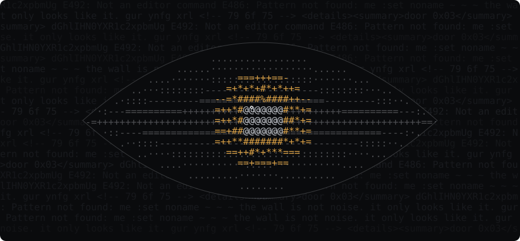

<!--
  you opened the source. good. most people only look at the surface.

  79 6f 75 20 77 65 72 65 20 74 68 65 20 63 75 72
  73 6f 72 20 74 68 65 20 77 68 6f 6c 65 20 74 69
  6d 65 2e 20 3a 71
-->

<p align="center">
  
</p>

<p align="center">
  
</p>

<p align="center"><sub><code>it was reading before you arrived.</code></sub></p>

<p align="center">
  
</p>

<p align="center"><sub><code>the wall is not noise. some of it refuses to move.</code></sub></p>

<br>

<details>
<summary><code>░▒ door 0x01</code></summary>
<br>

`E37: No write since last change (add ! to override)`

</details>

<details>
<summary><code>▒▓ door 0x02</code></summary>
<br>

<details>
<summary><code>deeper</code></summary>
<br>

<details>
<summary><code>deeper</code></summary>
<br>

<details>
<summary><code>the pupil is closer than it looks</code></summary>
<br>

`nothing. you came all this way for nothing.`

`it noticed.`

</details>
</details>
</details>
</details>

<details>
<summary><code>▓░ door 0x03</code></summary>
<br>

```
dGhlIHN0YXR1c2xpbmUgaXMgcm90YXRlZCBieSB0aGlydGVlbi4=
```

</details>

<details>
<summary><code>░▓ door 0x04</code></summary>
<br>

`E486: Pattern not found: me`

</details>

<details>
<summary><code>▒░ door 0x05</code></summary>
<br>

`E173: 1 more file to edit`

</details>

<br>

<p align="center">
  
</p>

<p align="right"><a href="#"><code>:q</code></a></p>
